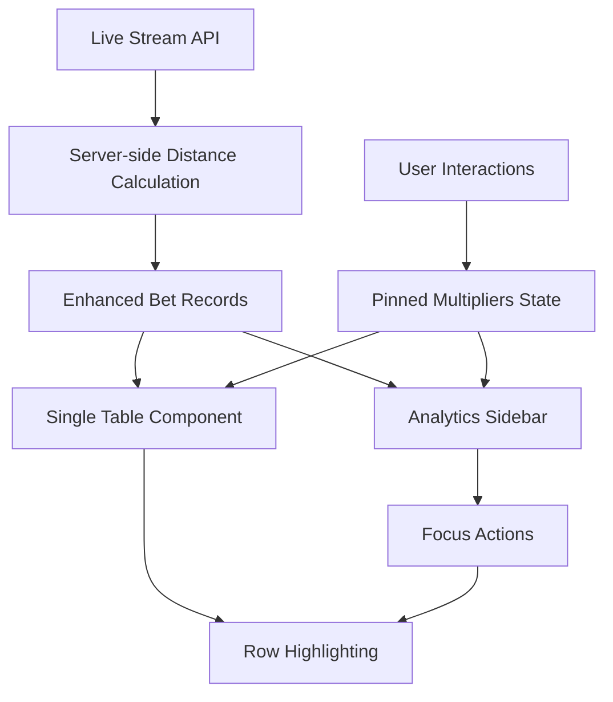

# Design Document

## Overview

This design document outlines the technical approach for implementing a streamlined LiveStreamDetail page with a single enhanced betting stream table and intelligent analytics sidebar. The design eliminates dual-table complexity while preserving all analytical capabilities through smart UI architecture and server-side optimizations.

## Architecture

### Technology Stack Update

**Primary Table Library:** Mantine React Table (MRT)
- Built on TanStack Table with Mantine UI components
- Excellent performance for large datasets with built-in virtualization
- Rich feature set: filtering, sorting, export, keyboard navigation
- Better styling flexibility with Tailwind integration
- Efficient real-time data handling

### High-Level Component Structure

```
LiveStreamDetailPage
├── MantineProvider (theme configuration)
├── MainContent (70/30 split on xl+ screens)
│   ├── MantineReactTable (70%)
│   │   ├── Built-in toolbar integration
│   │   ├── Custom distance column renderer
│   │   ├── Row highlighting for pinned multipliers
│   │   ├── Real-time data streaming
│   │   ├── Built-in filtering and sorting
│   │   └── Integrated export functionality
│   └── AnalyticsSidebar (30%)
│       ├── PinnedMultiplierCards
│       ├── StatisticsDisplay
│       ├── ETACalculations
│       └── AlertsSection
```

### Data Flow Architecture



## Components and Interfaces

### 1. Mantine React Table Configuration

**Purpose:** Single source of truth for all betting data with integrated analytics using MRT

**Key Features:**
- Built-in virtualization for 50k+ rows
- Integrated toolbar with custom controls
- Server-calculated distance column with custom renderer
- Real-time row highlighting for pinned multipliers
- Built-in filtering, sorting, and export
- Keyboard navigation and accessibility

**MRT Configuration:**
```typescript
interface MantineTableConfig {
  data: EnhancedBetRecord[];
  columns: MRT_ColumnDef<EnhancedBetRecord>[];
  enableRowVirtualization: true;
  enableStickyHeader: true;
  enableFilters: true;
  enableSorting: true;
  enableExport: true;
  mantineTableProps: {
    highlightOnHover: true;
    withBorder: true;
    withColumnBorders: false;
  };
  renderTopToolbar: CustomToolbarComponent;
  getRowProps: (row) => ({
    style: getPinnedMultiplierRowStyle(row.original.multiplier);
  });
}
```

**Custom Column Definitions:**
```typescript
const columns: MRT_ColumnDef<EnhancedBetRecord>[] = [
  {
    accessorKey: 'nonce',
    header: 'Nonce',
    size: 100,
    Cell: ({ cell }) => (
      <span className="font-mono tabular-nums">
        {cell.getValue<number>().toLocaleString()}
      </span>
    ),
  },
  {
    accessorKey: 'distance_to_prev',
    header: 'Distance',
    size: 80,
    Cell: ({ cell }) => <DistanceCell value={cell.getValue()} />,
    filterFn: 'greaterThan',
  },
  {
    accessorKey: 'multiplier',
    header: 'Multiplier',
    size: 90,
    Cell: ({ cell }) => (
      <MultiplierCell 
        value={cell.getValue()} 
        isPinned={pinnedMultipliers.has(cell.getValue())}
        onClick={() => onMultiplierClick(cell.getValue())}
      />
    ),
  },
  // ... other columns
];
```

**Enhanced Data Model:**
```typescript
interface EnhancedBetRecord extends BetRecord {
  distance_to_prev?: number | null; // Server-calculated
  is_pinned_match: boolean;         // Client-calculated
  highlight_until?: number;         // For glow effects
}
```

### 2. Analytics Sidebar

**Purpose:** Consolidated analytics interface replacing the Multiplier Tracker

**Key Sections:**
- **Pinned Multiplier Cards:** Stats grid with Count, Last Nonce, Last Gap, Mean Gap, P90 Gap, Max Gap
- **ETA Display:** Theoretical vs observed calculations with color coding
- **Quick Actions:** Focus, Remove, Show buttons per multiplier
- **Alerts Panel:** Gap alerts and cluster notifications

**Props Interface:**
```typescript
interface AnalyticsSidebarProps {
  pinnedMultipliers: Map<number, PinnedMultiplierStats>;
  streamMultipliers: number[];
  difficulty: DifficultyLevel;
  onPinMultiplier: (multiplier: number) => void;
  onUnpinMultiplier: (multiplier: number) => void;
  onFocusMultiplier: (multiplier: number) => void;
  alerts: Alert[];
}
```

### 3. Sticky Controls Toolbar

**Purpose:** Always-visible controls for filtering and stream management

**Layout:**
- **Left Cluster:** Min Multiplier input, Difficulty dropdown, Freeze UI toggle
- **Right Cluster:** Pinned multiplier chips (first 5), Add button, overflow menu, live stats

**State Management:**
```typescript
interface ToolbarState {
  minMultiplier: number;
  difficultyFilter: DifficultyLevel;
  freezeUI: boolean;
  pinnedMultipliers: Set<number>;
  liveStats: {
    lastNonce: number;
    timeDelta: number;
    hitsPerMin: number;
    totalBets: number;
  };
}
```

## Data Models

### Server-Side Distance Calculation

**Implementation:** Maintain a `last_nonce_by_multiplier` map during bet ingestion

```python
# Pseudo-code for server-side distance calculation
class DistanceCalculator:
    def __init__(self):
        self.last_nonce_map: Dict[float, int] = {}
    
    def calculate_distance(self, bet: BetRecord) -> Optional[int]:
        multiplier = round(bet.multiplier, 2)  # Normalize precision
        last_nonce = self.last_nonce_map.get(multiplier)
        
        if last_nonce is None:
            distance = None  # First occurrence
        else:
            distance = bet.nonce - last_nonce
            
        self.last_nonce_map[multiplier] = bet.nonce
        return distance
```

### Client-Side Analytics Models

**Pinned Multiplier Statistics:**
```typescript
interface PinnedMultiplierStats {
  multiplier: number;
  count: number;
  lastNonce: number;
  lastGap: number | null;
  meanGap: number;
  p90Gap: number;
  maxGap: number;
  eta: {
    value: number;
    model: 'theoretical' | 'observed';
  };
  alerts: MultiplierAlert[];
}
```

**Alert System:**
```typescript
interface Alert {
  id: string;
  type: 'gap' | 'cluster';
  multiplier: number;
  message: string;
  timestamp: number;
  severity: 'info' | 'warning' | 'critical';
  autoHide: boolean;
}
```

## Error Handling

### Real-time Update Failures
- **Graceful Degradation:** Continue showing existing data
- **Retry Logic:** Exponential backoff for reconnection
- **User Feedback:** Toast notifications for connection issues

### Distance Calculation Errors
- **Fallback:** Show "—" for missing distance data
- **Logging:** Track calculation failures for debugging
- **Recovery:** Re-sync distance map on reconnection

### Memory Management
- **Row Limit:** Cap at 50k rows with "Show older" pagination
- **Cleanup:** Remove old alerts and temporary highlights
- **Debouncing:** 250ms debounce for expensive sidebar calculations

## Testing Strategy

### Unit Tests
- **Distance Calculations:** Verify server-side distance logic
- **Analytics Functions:** Test mean, P90, ETA calculations
- **State Management:** Pinned multipliers and filtering logic

### Integration Tests
- **Real-time Updates:** Test live data flow and UI updates
- **Sidebar Interactions:** Focus actions and multiplier management
- **Performance:** Large dataset handling and memory usage

### End-to-End Tests
- **User Workflows:** Pin multiplier → focus → analyze pattern
- **Responsive Behavior:** Sidebar collapse on smaller screens
- **Keyboard Navigation:** Accessibility and shortcuts

## Performance Considerations

### Server-Side Optimizations
- **Incremental Distance Calculation:** O(1) per bet using hash map
- **Batch Updates:** Send distance data with bet records
- **Memory Efficiency:** Periodic cleanup of old nonce mappings

### Client-Side Optimizations
- **Efficient Rendering:** React.memo for table rows and sidebar cards
- **Debounced Updates:** Prevent excessive re-renders during rapid updates
- **Virtual Scrolling:** Only for tables exceeding 2k rows
- **State Normalization:** Use Maps for O(1) lookups

### Memory Management
- **Row Capping:** Automatic cleanup when exceeding limits
- **Weak References:** For temporary highlights and animations
- **Garbage Collection:** Regular cleanup of expired alerts and effects

## Implementation Phases

### Phase 1: Core Table Enhancement
1. Add distance column to betting stream table
2. Implement server-side distance calculation
3. Add multiplier highlighting and click handlers
4. Basic pinned multiplier state management

### Phase 2: Analytics Sidebar
1. Create sidebar component structure
2. Implement pinned multiplier cards with statistics
3. Add ETA calculations and display
4. Integrate focus actions with table highlighting

### Phase 3: Advanced Features
1. Alert system for gap and cluster detection
2. Keyboard navigation and accessibility
3. Export functionality with sidebar data
4. Performance optimizations and testing

### Phase 4: Polish and Testing
1. Responsive design and mobile optimization
2. Comprehensive testing suite
3. Performance monitoring and optimization
4. Documentation and user guides

This design provides a clear path to implement the streamlined single-table architecture while maintaining all analytical capabilities through the intelligent sidebar approach.